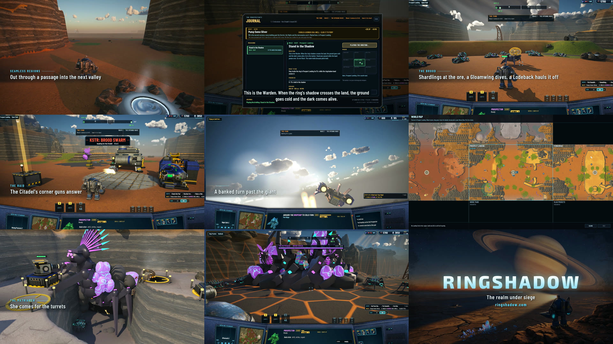
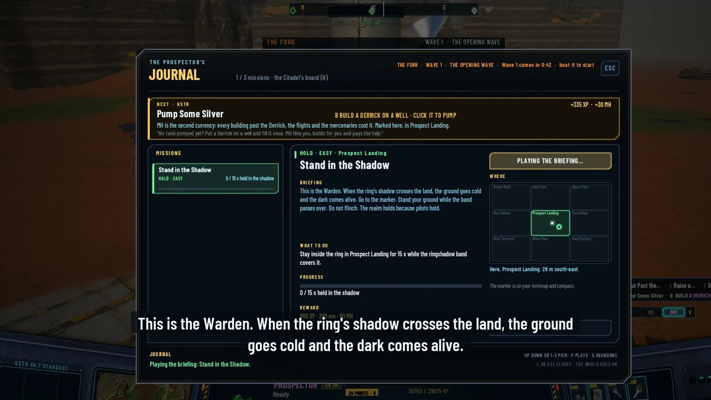
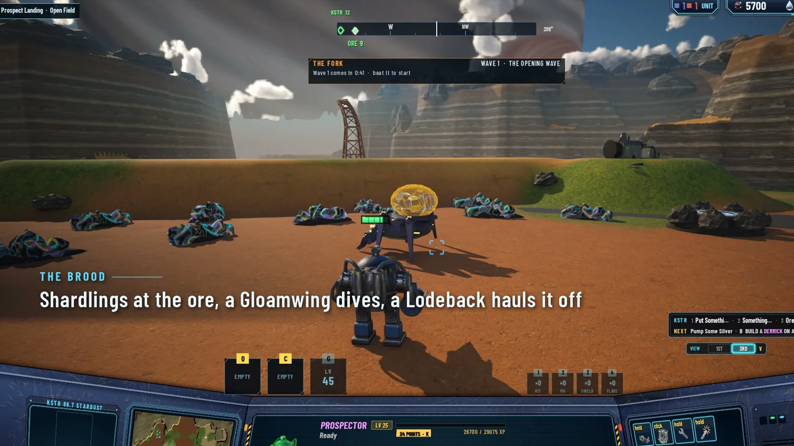
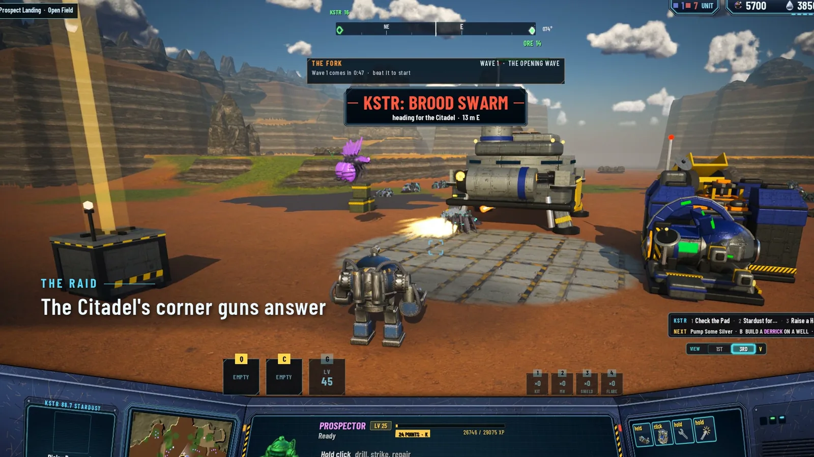
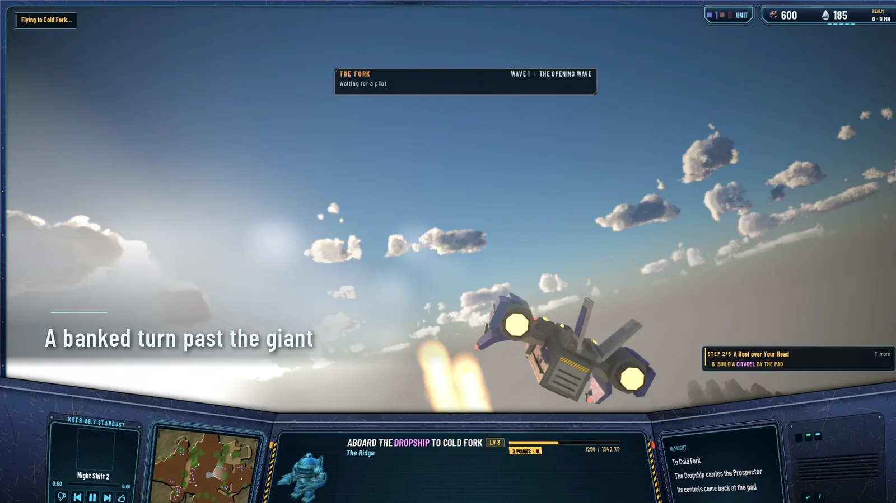
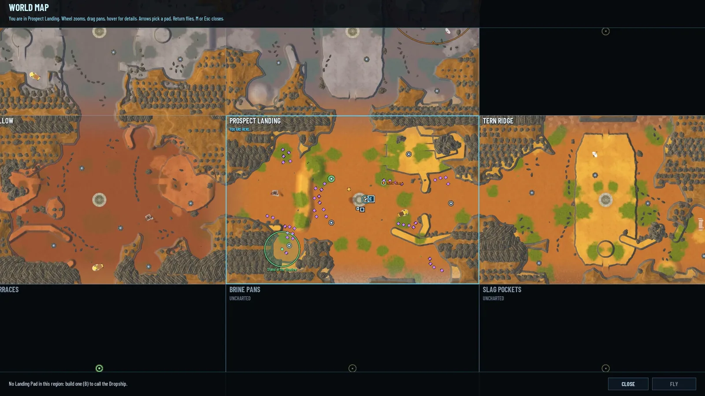
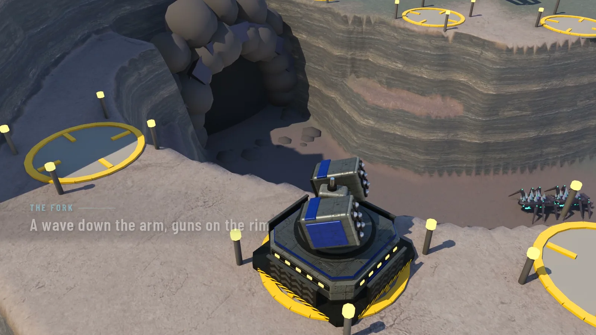
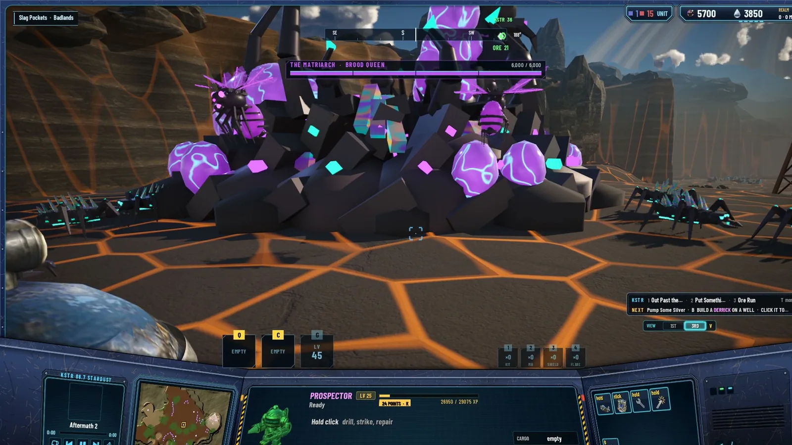

# The Realm Under Siege: What Ringshadow's Agents Built Overnight After I Asked "Now What?"

> Orchestrator draft: xd_dcf3cf44. Header image: realm-under-siege/thumb.jpg (2000 × 800). Inline images: beats.jpg and six stills from the reel.
> The reel itself can't come in from markdown: insert it by hand in the editor (Insert → Media) from unreal/server/build/v4/ringshadow-m8-showreel-web.mp4 (14.2 MB), right under the first paragraph.

On the evening of 14 October I played Ringshadow's online mode up to level 10 and ran out of things to do. I wrote down what was missing. By 08:14 the next morning the agents had built the list and cut a reel of it. This is the reel, beat by beat, with the numbers behind each one.

Ringshadow is an open-source Mac game in Unreal Engine 5. Claude Code writes all of its code, Grok paints the art, Suno makes the music, and I direct. The online mode is one pilot in a frontier world that lasts, on a server the agents wrote.

- **137 commits** landed on the integration branch between the first task of the milestone and the reel.
- **67.4 seconds** of reel, 1080p at 30 frames a second, recorded by an agent in hidden runs of the game.
- **10 waves** down the canyon called The Fork, and a queen with 6,000 hp if a wave gets through.
- **16 to 20 seconds** of Dropship flight between two regions, without a fade.

## What I asked for

My remarks came in three rounds that evening. Buildings belong to the realm, so every pilot uses every building. The Citadel takes a tax, sells things, and defends itself. Alien bugs are drawn to the places worth being; a giant queen lives somewhere with many of them around her. The Prospector can no longer fly alone: a Dropship carries it between landing pads. Regions stop looking like rectangles. Then a second round: missions picked from a board at the Citadel with a Journal and a narrator, a map that is a satellite view of the real ground, mercenaries that mine slowly, and a server that keeps running when the game is closed. Then a third: some canyons play as tower defence, and if the pilots fail, the queen comes and fells every turret.

A manager agent turned those into tasks, two workers built them at a time in their own copies of the repository, and the manager merged what passed. Every task on that night's list is merged, the stability pass included.

## 0:00. Dawn, and a valley without seams

The reel opens at Prospect Landing at dawn under the ringed giant, then the Prospector walks out through a passage into the next valley. **Region borders follow the land now.** There are 14 passages between the 9 regions, the walls meander and step, and between 50% and 66% of each region's cell is open land. Crossing on foot hands the pilot from one region's server state to the next without a seam; the worst frame during a crossing measured 13.2 ms.

## 0:08. The Citadel, taxed and open for business

Three screens in a row: the realm, the shop and the missions board, then the Journal. **The Citadel takes 10% of every unload into a realm wallet**, which pays for the Citadel's own upgrades, and pilots can donate on top. The shop sells four consumables (a repair kit, an MH canister, a shield charge and a survey flare) and every blueprint, from the pilot's own wallet. A blueprint's price is (50 + 25 × floor) × 1.5 to the power of copies bought, in ore, so the first Hab Dome costs 250 ore and 40 MH, and the next copy costs more.

The missions board has three tiers, easy, hard and perilous, with two offers per tier and at most three missions taken at once. A taken mission goes into the Journal with its text, its place on the map and a narration you can replay. There are 16 narrations in three voices, generated offline and shipped as sound files. The reel's one spoken line is the Warden's: "When the ring's shadow crosses the land, the ground goes cold and the dark comes alive."

## 0:17. The Brood

Shardlings at the ore, a Gloamwing diving, a Lodeback hauling ore away in its sac. **Four kinds of bug, each with its own glow**, drawn to deposits, sites, buildings and pads. They linger, bite a pilot that walks into their site, chew on the realm's buildings, and eat unguarded veins: a Lodeback fills its back sac and leaves with it. The Shardling is a six-legged bug with opal quills, 20 hp. The Gloamwing flies and spits acid, 30 hp. The Lodeback is the ore eater, 120 hp with armour. I picked each one's look from a page of Grok concepts.

With 17 to 19 bugs on screen the mean frame time went from 10.42 ms to 10.77 ms after the art pass, which is the whole cost of them.

## 0:24. The raid, and the guns that answer

KSTR, the radio, calls a brood swarm heading for the Citadel. **The Citadel comes with four point-defence turrets, one at each corner, at no cost**, and they fire on their own. The realm wallet buys their marks: +20% fire rate, +25% damage and +1 range, three of each, from 250 ore up to 1,000 ore and 150 MH.

Then the gatling gun, firing red-hot rounds of ore and MH amalgam. It is a blueprint at level 5, reaches 6 cells on the ground and 4.5 in the air. The AA tower is the Sentinel, at level 10, air only. Both take marks the pilot pays for at the turret. The Prospector's own torch stays weak on purpose: it builds, it doesn't fight well.

## 0:28. The Dropship

Board at a Landing Pad, lift, a banked turn past the giant, down on the pad in a new region. **The Prospector no longer flies on its own.** A Landing Pad is a level-1 building, an 80-ore blueprint and 60 ore to build, two per region, and the Dropship flies only between pads that pilots built, in regions already discovered. The flight takes 16 to 20 seconds and never fades to black: the agents measured 10.8 ms median and 12.2 ms at the 95th percentile during the flight, and 1.6 ms for the region change itself.

## 0:36. The map

The world map is a satellite view now: a top-down render of the real ground of every discovered region, stitched, whatever shape the region has. The agents bake one texture per region, 9 of them, and draw the live things on top: pilots, buildings, deposits, each with a tooltip saying what it is, how much ore is left and who built it. Click a place and the pilot has a target.

## 0:42. The Fork

A wave comes down the canyon's arm while guns wait on the rim. **The Fork is the first canyon that plays as tower defence**, cut into Cold Fork with two arms from the Brood's tunnels to a prize of ore and MH, and 12 build spots along the rims. The opening wave is four Shardlings and it replays until the pilots beat it. Then waves 2 to 10 come 30 seconds apart; wave 10 is 34 bugs. A wave breaks through when its bugs carry off 300 ore of the prize or its time runs out. Each wave beaten pays everyone who fought it, by damage done: 200 × n XP, 150 × n ore and 40 × n MH for wave n, double that for wave 10 plus a rare blueprint. Hold all ten and the canyon is the pilots' to mine for a world day, which is 40 minutes.

## 0:52. The Matriarch

If a wave gets through, the whole world hears THE FORK HAS FALLEN, and she comes out of the tunnel that wave came from, with six Shardlings. **She fells every turret in the canyon, nearest first, and goes home**, and the canyon resets to the opening wave with the prize full. She has 6,000 hp and armour 3, so a lone pilot's torch does 2 a strike and can't kill her; the defences built at her nest can. Her slam does 40 to every ground unit within 3 cells in front of her, 60 to buildings, her spit does 18 at 12 cells, and her roar rallies her bugs and hatches four more. Killing her pays 3,000 ore and 1,500 MH, split by damage, and a rare blueprint to each fighter. She is back in three world days.

The reel ends at her nest in Slag Pockets, among the egg pods, with the song still rising.

## What the reel leaves out

- **The world runs on.** The server keeps running after the game quits, as long as the Mac is on, and the game reattaches to it on start. Idle, it ticks at 2 Hz and costs about 0.008% of a CPU. If it was stopped, it catches up at most 24 hours of what the world would have done.
- **Mercenaries.** Hired at the Citadel for 500 ore and 50 MH, doubling with each one, plus a daily wage of 5 MH and a fifth of your level. Each mines an area at a twenty-fourth of a pilot's rate, taxed like any unload, and keeps going while the game is closed.
- **One goal at a time.** After the opening, KSTR keeps the next useful goal in front of you from a chain of 15, by level, because a pilot at level 10 asked "now what?".
- **Frontier pilots**, merged the morning after the reel: five pilots of the server's own in every world, with callsigns, paints and habits (miner, builder, defender, wanderer), playing by the same rules as a human. They arrive by Dropship 45 seconds after a new pilot finishes the opening.

## How the reel was made

An agent recorded each beat with a shot script that drives the game through hidden runs: the game runs invisible and silent, one run at a time on the whole Mac, and a clip mode drops the HUD for the clean moments. A cut file lists each shot's source, in and out points, a zoom and a focus point, a kicker and a caption; a Python script pans, subtitles and joins them with half-second crossfades, and puts the end card over the key art. The music bed is Rising Pressure, one of our own songs from Suno, mixed offline at −16 LUFS. The master is 105 MB; the web copy is 14.2 MB.

Before the reel, a stability pass fixed the flaky checks at their causes and reran everything on the current build: 27 shot sets, 6 flows, 92 of 92 automation tests, and the suites at 496 core, 267 server and 88 network tests, all passing.

## What's open

The next milestone is a living frontier: more canyons, a balance pass over the bugs and the pay, a sound pass, and a packaged build. The frontier pilots are in, and the question I'm turning over now is what they should do when no human is in the world. Keep mining and building, as they do now, or go quiet?

Hold a canyon with me when it ships, or tell me what the Brood should be afraid of.

<!--
Sources:
- Remarks, three rounds on 2026-10-14: docs/mmorpg-m8.md "Decided".
- 137 commits: git log --oneline 0a42c5a^..01ed934 on worktree/MMORPG-variant (B1 at 2026-10-14 20:19 to V4 at 2026-10-15 08:14).
- Reel 67.4 s, 1920×1080, 30 fps, web copy 14,210,330 bytes: ffprobe on ringshadow-m8-showreel-web.mp4; master 105,407,092 bytes; log "V4 done 01ed934: M8 showreel 67.4 s 1080p, web copy 14.2 MB, 8 beats + end card".
- Beat times: edit.json (in/out/rate per shot, 0.5 s fades), cumulative minus the fades.
- Rising Pressure, −16 LUFS: log "V4 music bed"; the song: docs/music.md.
- 14 passages, 9 regions, walls meander, land 50 to 66% of each cell, crossing worst frame 13.2 ms: log W4 done, W4b.
- 10% tax, donate: log C1 done. Shop: C2 done, price (50+25F)·1.5^n ore, first Hab Dome 250+40; 4 consumables.
- Missions 3 tiers, 2 offers per tier, max 3 taken, 16 narrations, 3 voices: log K2.
- Brood hp 20/30/120, armour: docs/creatures.md. Frame time 10.42 → 10.77 ms with 17 to 19 bugs: log N1b step 1.
- Citadel 4 free corner turrets: docs/mmorpg-m8.md; marks +20%/+25%/+1 ×3, 250 ore → 1,000 + 150 MH: log D1.
- Gatling level 5, ground 6, air 4.5; AA = Sentinel at level 10: log D2.
- Landing Pad level 1, 80 ore blueprint, 60 to build, 2 per region; 16 to 20 s, no fade; p50 10.8, p95 12.2, region change 1.6 ms: log F2.
- 9 baked region textures, tooltips, click-to-target: log M2.
- The Fork: 2 arms, 12 spots: log Z1. Waves, 34 bugs, 300 ore, pay, world day 40 min: docs/canyon.md.
- Matriarch 6,000 hp, armour 3, slam 40/60, spit 18 at 12, roar hatches 4, kill 3,000 + 1,500 + rare blueprint, back in 3 days: docs/creatures.md and log N3.
- Server idle 2 Hz, ~0.008% CPU, catch-up capped at 24 h: log S2.
- Mercs fee 500 ore + 50 MH doubling, wage 5 + level/5 MH, 1/24 rate: log H2.
- 15 goals: log L1.
- Frontier pilots: docs/frontier.md (5 per world, 4 habits, 45 s after O1); merged e43247c 2026-10-15 09:39.
- Stability pass 27 shot sets, 6 flows, 92/92, suites 496/267/88: log Q2.
- M9 plan: log "M9 'a living frontier'".
-->
